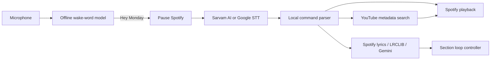

<p align="center">
  
</p>

<h1 align="center">LyricLatch</h1>

<p align="center">
  A multilingual, voice-first Spotify companion that finds the song you mean and loops the exact part you want.
</p>

<p align="center">
  
  
  
</p>

LyricLatch adds hands-free music control to the Spotify desktop client through Spicetify. Its local ONNX wake-word model listens for **“Hey Monday”** without streaming ambient audio. Once awakened, it pauses playback, transcribes one command, and controls the active Spotify session.

Its signature feature is an interactive lyric loop: say **“loop song part”**, then answer the spoken follow-up with lyrics or a timestamp range. LyricLatch locates the section, repeats it, and lets you adjust the loop by voice.

> [!IMPORTANT]
> LyricLatch is an independent Spicetify customization. It is not affiliated with, endorsed by, or supported by Spotify, Google, YouTube, Sarvam AI, or LRCLIB. Spicetify integrations may need updates when Spotify changes its desktop client.

## Highlights

- Offline **Hey Monday** wake-word detection with ONNX Runtime Web.
- Hindi, English, code-mixed, and multilingual commands through Sarvam AI, with Google Cloud Speech-to-Text fallback.
- Song discovery from an imperfect title, artist clue, or remembered lyric using YouTube metadata before Spotify search.
- Playback commands for pause, resume, next, previous, repeat, volume, and relative or exact seeking.
- Two-turn voice dialog for lyric or timestamp section loops.
- Spotify synchronized lyrics first, LRCLIB fallback second, and Gemini-assisted fuzzy matching for difficult transliterations.
- Local companion bound to `127.0.0.1`; cloud credentials never enter the Spotify UI.

## How it works



The wake phrase is processed locally. Audio captured during the command window is sent to the configured speech provider. Song queries may be sent to YouTube, and lyric-loop requests may use LRCLIB and Vertex AI. Review the providers’ privacy terms before use.

## Requirements

- Windows 10 or 11 with the Spotify desktop app
- [Spicetify CLI](https://spicetify.app/docs/getting-started/)
- Node.js 22 or newer
- A [Sarvam AI](https://docs.sarvam.ai/api-reference-docs/getting-started) API key for the best Indic/code-mixed transcription experience
- A YouTube Data API v3 key for metadata-assisted song matching
- A Google Cloud project with Application Default Credentials for speech fallback and Gemini lyric matching

Sarvam and YouTube are optional at runtime, but their related features will show as not configured. Google Cloud is optional when you do not need Google speech fallback or Gemini lyric matching.

## Installation

Clone or download the repository, then open PowerShell in it:

```powershell
cd customization
npm ci
Copy-Item .env.example .env
```

Edit `customization/.env` with your own configuration:

```dotenv
SARVAM_API_KEY=your_sarvam_key
YOUTUBE_API_KEY=your_youtube_key
GOOGLE_CLOUD_PROJECT=your_gcp_project_id
COMPANION_PORT=43821
```

For Google Cloud features, enable Speech-to-Text and Vertex AI in that project, install the Google Cloud CLI, and create local Application Default Credentials:

```powershell
gcloud auth application-default login
gcloud auth application-default set-quota-project YOUR_PROJECT_ID
```

Build and deploy LyricLatch:

```powershell
npm run check
npm run build
npm run deploy
spicetify config custom_apps lyriclatch
spicetify config extensions lyriclatch.js
spicetify apply
```

Keep the companion running in a separate PowerShell window while using voice features:

```powershell
cd customization
npm run companion
```

Open LyricLatch from Spotify’s sidebar and confirm that the required services show **Ready**. Use the microphone button in Spotify’s top bar to enable the wake-word listener.

## Voice commands

Say **“Hey Monday”**, wait for the listening prompt, and then speak a command.

| Goal | Example commands |
| --- | --- |
| Find and play | “Play Monta Re”, “play the Kishore Kumar song with the line…” |
| Pause or resume | “Stop”, “pause”, “resume”, “continue” |
| Change track | “Next”, “skip”, “previous track”, “go back” |
| Repeat | “Repeat this song”, “loop playlist”, “stop repeat” |
| Seek relatively | “Skip 30 seconds”, “rewind 15 seconds”, “forward 2 minutes” |
| Seek exactly | “Go to 1 minute 20 seconds” |
| Start a section loop | “Loop song part” |
| Answer the follow-up | “From 1:20 to 1:35” or “starting with raghupati raghav” |
| Refine the loop | “Make it longer”, “make it shorter”, “next occurrence” |
| End the loop | “Stop loop”, “I’m satisfied” |

“Previous” follows Spotify’s normal behavior: when the current track has played for several seconds, the first request restarts it; a second request within the retry window moves to the previous queue item.

Section looping needs timed lyrics or an explicit timestamp range. If neither Spotify nor LRCLIB has synchronized lyrics for a track, answer the follow-up with a range such as **“from 1:20 to 1:35.”**

## Development

Run these commands from `customization/`:

| Command | Purpose |
| --- | --- |
| `npm run check` | Type-check all source files |
| `npm run build` | Build the app, extension, and companion |
| `npm run watch` | Rebuild continuously during development |
| `npm run deploy` | Copy the latest build into Spicetify on Windows |
| `npm run test:wake-word` | Validate the ONNX wake-word pipeline |
| `npm run test:speech -- <wav>` | Test command transcription with 16 kHz mono PCM audio |
| `npm run test:lyric-loop` | Test lyric matching and section-loop behavior |
| `npm run test:loop-dialog` | Test the two-turn clarification dialog |

Live tests call configured services or Spotify and are intentionally excluded from CI. They are available as `test:section-loop-live`, `test:voice-pipeline`, and `test:spotify-live`.

## Troubleshooting

- **Companion unavailable or `ERR: [wasm]`** — run `npm run build`, start `npm run companion`, then verify [http://127.0.0.1:43821/health](http://127.0.0.1:43821/health).
- **Voice command network error** — confirm the companion is running and at least one speech provider is configured.
- **Song not found** — configure `YOUTUBE_API_KEY`; LyricLatch will use the result’s title and channel metadata to improve Spotify search.
- **Google fallback fails** — set `GOOGLE_CLOUD_PROJECT`, enable the APIs, and refresh Application Default Credentials.
- **Changes do not appear** — run `npm run build`, `npm run deploy`, and `spicetify apply`, then restart Spotify.

## Repository hygiene

Secrets, dependencies, source maps/build output, local reference clones, and duplicate model exports are excluded from Git. CI type-checks, tests, and builds every proposed change. See [SECURITY.md](SECURITY.md) for responsible disclosure and credential guidance.

## License

LyricLatch’s original source and branding are available under the [MIT License](LICENSE). Bundled or referenced third-party components retain their own licenses; see [THIRD_PARTY_NOTICES.md](THIRD_PARTY_NOTICES.md).
